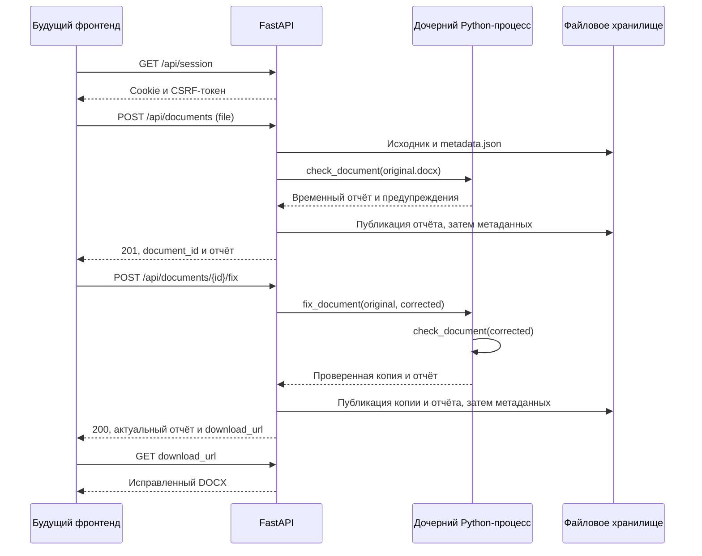

# Проект проверки технической документации

Состояние документа: 24.10.2026. Документ описывает текущую реализацию и решения
для продолжения разработки в новом чате. Операторские команды — в
[BACKEND.md](../BACKEND.md), интеграция будущего интерфейса — в
[FRONTEND.md](FRONTEND.md), инструкции для ИИ-разработчика — в
[AGENTS.md](../AGENTS.md).

## Назначение и границы MVP

Пользователь загружает курсовую или другую техническую документацию в DOCX.
Система проверяет доступные по структуре документа требования оформления СТП,
возвращает замечания, по отдельному запросу исправляет поддерживаемые нарушения
и повторно проверяет исправленную копию.

В текущей версии реализован только бэкенд. Фронтенд предстоит создать.
Его фреймворк и визуальный стиль пока не определены. Публикация сайта,
настройки VPS и контейнерная конфигурация не входят в текущую реализацию.

Используется один СТП 01–2017 с согласованными уточнениями заказчика.
В реестре 31 правило с ID F01–F36, исключая F11, F13, F14, F17 и F21.
Наличие правила в реестре не означает полного покрытия требования:
например, F16 отложено, а многие проверки покрывают только структурные признаки.
Точное покрытие описано в `formal_check/coverage.py`.

В этой версии отсутствуют:

- смысловой анализ и обращения к LLM;
- OCR и распознавание содержимого изображений;
- рендеринг DOCX, вычисление фактических страниц и геометрии вёрстки;
- пересчёт полей и содержания Word;
- аккаунты, восстановление доступа, общая история загрузок в API;
- база данных, внешняя очередь и распределённая обработка.

Модули смыслового анализа могут быть добавлены отдельным этапом. Не включайте
их в формальную проверку и не представляйте их как готовую возможность.

## Обязательные продуктовые решения

| Решение | Текущее поведение |
| --- | --- |
| Хранение | Один основной файловый каталог, без базы и отдельного архива |
| Срок | Все принятые документы и опубликованные результаты сохраняются постоянно |
| Удаление | Нет пользовательского или административного API удаления, TTL и команды очистки |
| Аналитика | Исходники и отчёты сохраняются для будущей аналитики; аналитических отчётов и API пока нет |
| Исходник | Не изменяется при проверке и исправлении |
| Исправление | Только поддержанные нарушения; отдельный DOCX и полная повторная проверка |
| Доступ | Анонимная подписанная сессия; принадлежность проверяет бэкенд |
| Параллельность | Несколько независимых DOCX-операций одновременно, настраиваемое число процессов |
| Масштаб | Один API-процесс и один сервер с локальным диском |

Если хранилище заполнено, отклоняется новая операция. Старые документы для
освобождения места не удаляются. Потеря сессии не удаляет сохранённые данные.

«Все принятые» не означает обход ограничений приёма: запросы, отклонённые до
сохранения из-за неподдерживаемого формата, размера, занятых обработчиков или
отсутствия места, не гарантируют наличия файла в хранилище.

## Структура кода

```text
app/
  main.py           # create_app(), lifespan, middleware, обработка исключений
  routes.py         # HTTP API сессии, загрузки, отчёта, исправления и скачивания
  config.py         # Settings из окружения
  security.py       # подписанная cookie и CSRF
  storage.py        # UUID-каталоги, атомарный JSON, восстановление после запуска
  service.py        # последовательность операций и публикация результата
  runner.py         # запуск дочерних процессов, тайм-аут, остановка
  worker.py         # проверка архива, вызов модулей, временный результат
formal_check/       # чтение DOCX, модель, классификация, правила, контракт отчёта
formal_fix/         # выбор и применение поддержанных исправлений
tests/test_web.py   # интеграционные тесты с генерируемыми DOCX
requirements.lock  # проверенные версии runtime-зависимостей
requirements.txt   # диапазоны прямых зависимостей для намеренного обновления
requirements-dev.txt
BACKEND.md
docs/
  PROJECT.md
  FRONTEND.md
AGENTS.md
```

`formal_check/viewer.py` — старый генератор автономного HTML. Нужного ему
`formal_check/templates/report.html` в этой поставке нет. Он не является
реализованным веб-интерфейсом и не используется API.
Исходного файла СТП и старых примеров `docs/1.docx`, `docs/2.docx` здесь также нет.

## Выполнение операций



Оба POST-запроса ожидают завершения обработки. Ответа `202`, серверного `job_id`
или сообщения о проценте выполнения нет. `document_id` первой загрузки
возвращается только после успешной проверки.

`formal_fix.fix_document()` возвращает `None`. Внутри он повторно вызывает
`formal_check.inspect_document()`, получает точные объекты и применяет разрешённые
операции. Публичный JSON не является планом исправлений. После исправления
`app.worker` вызывает полный `check_document()` для копии.

Повторный `/fix` после успеха возвращает уже сохранённый результат и не запускает
новое исправление. Повторная загрузка DOCX, напротив, создаёт новый UUID и
сохраняет ещё один исходник. Дедупликации и связи между такими загрузками нет.

## Публикация и сохранность данных

```text
storage/
  .session-secret
  .server.lock
  documents/
    <document_id>/
      metadata.json
      original.docx
      original-report.json
      original-warnings.json
      corrected.docx
      corrected-report.json
      corrected-warnings.json
```

По умолчанию корень `storage/` находится в корне проекта; переопределяется
через `STORAGE_DIR`. Он не должен попадать в Git, статику или публичную сборку фронта.

Каждый worker пишет в уникальную `.work-*` внутри папки документа. Основной
процесс независимо валидирует отчёт, переносит файлы под конечные имена и
последним атомарно обновляет `metadata.json`. Наличие `corrected.docx` на диске
само по себе не разрешает скачивание — учитывается опубликованная версия.

Метаданные содержат `id`, `owner_id`, `original_filename`, `created_at`,
`expires_at`, `state`, `current_version`, `checker_version`, `ruleset_version`
и `last_error`. `expires_at` всегда `null`; старые сроки снимаются при запуске.
Внешний контракт перечислен в `docs/FRONTEND.md`; `owner_id` наружу не передаётся.

Если проверка завершилась ошибкой, полученный `original.docx` остаётся на диске.
При прерывании переноса принятой загрузки полученная часть остаётся в `.upload`
с состоянием `failed`. Исходный отчёт сохраняется, если исправление или повторная
проверка не удались. Ошибка никогда не подменяется пустым `findings`.

Служебные `.work-*` и временные JSON могут очищаться. Это не механизм удаления
пользовательских документов. При перезапуске незаконченные операции переводятся
в `failed`; автоматического продолжения нет.

Для будущей аналитики доступны исходники, обе версии отчёта, даты и версии
правил. Пока не реализованы SHA-256 для группировки повторных загрузок,
измерение времени обработки для аналитики, отдельный индекс или аналитический API.
Число замечаний до и после можно получить из отчётов; точное число операций
исправления из разницы этих чисел выводить нельзя.

## Параллельность и ограничения ресурсов

Один процесс Uvicorn управляет `asyncio.Semaphore` и набором выполняющихся
операций по UUID. `MAX_CONCURRENT_JOBS` по умолчанию равен 2. Можно увеличить
параллельность настройкой; тестируется обработка двух и четырёх документов.

Каждая операция запускает отдельный Python-процесс. Проверка и исправление
разных документов не должны блокироваться одной глобальной операцией.
Повторное исправление того же UUID во время операции даёт 409. При заполнении
всех слотов новая обработка даёт 503 с `Retry-After: 5`; ожидания в очереди нет.

`.server.lock` не позволяет запустить второй API с тем же хранилищем, чтобы он
не вмешивался в восстановление активных операций. Для этой архитектуры используйте
`--workers 1`; это не ограничение числа DOCX-обработчиков одним документом.

По умолчанию: файл до 20 МиБ, бюджет документов 2048 МиБ, операция до 60 секунд,
лимит адресного пространства одного worker в Linux 768 МиБ. Валидация ZIP
дополнительно ограничивает число и размеры частей. Полный список — в `BACKEND.md`.
На macOS действуют тайм-аут родителя и ограничения файлов; Linux также
ограничивает CPU и память и завершает worker при аварийном завершении родителя.

## Нормы и автоисправление

Текущая версия проверяющего модуля — `0.3.5`, набора требований —
`stp-01-2017-2026-10-22`. Версия HTTP-приложения — `0.1.0`.
Не путайте их и не используйте только название СТП как версию алгоритма.

Основания правил зафиксированы в `formal_check/standards.py`. В частности,
одинарный интервал F03 — согласованное уточнение заказчика; оно не должно
представляться фронтом как дословная норма самого СТП.

Поддерживаются F01, F03 и отдельные нарушения F04–F07. Исправитель выбирает
только безопасные операции со статусом `error`. Не исправляются `review`,
`recommendation`, шрифты и неподдержанные объекты. Точный список операций —
`formal_fix/operations.py:ALLOWED`; определять исправляемость по одному ID нельзя.
Для F05 разрешена специальная замена пробельного разделителя номера табуляцией;
не следует обещать побайтовую неизменность всего извлечённого текста копии.
Слова и нумерация защищаются проверками исправителя.

Если исправлять нечего, сохраняется копия, совпадающая с исходником побайтово.
Успешное исправление не гарантирует отсутствия оставшихся замечаний. Изменения
полей и интервалов могут сдвинуть страницы; окончательную вёрстку проверяют в Word.

## Как продолжать разработку

1. Прочитать `docs/FRONTEND.md` и запустить текущий API локально.
2. Выбрать с пользователем стек и реализовать реальный сценарий интерфейса.
3. Сохранить cookie/CSRF, контракт `report`, постоянное хранение и параллельность.
4. Проверить полный проход с реальным DOCX и отдельные сбои из списка приёмки.
5. Обновить документацию в части реально изменённого поведения.

Разработка интерфейса не требует переписывания правил оформления. Проверки
бэкенда: `.venv/bin/python -m pytest tests -q`. На момент подготовки документации
последний проверенный прогон — 28 интеграционных тестов. Это не старый набор
из README модулей: тот набор в этой поставке отсутствует.
